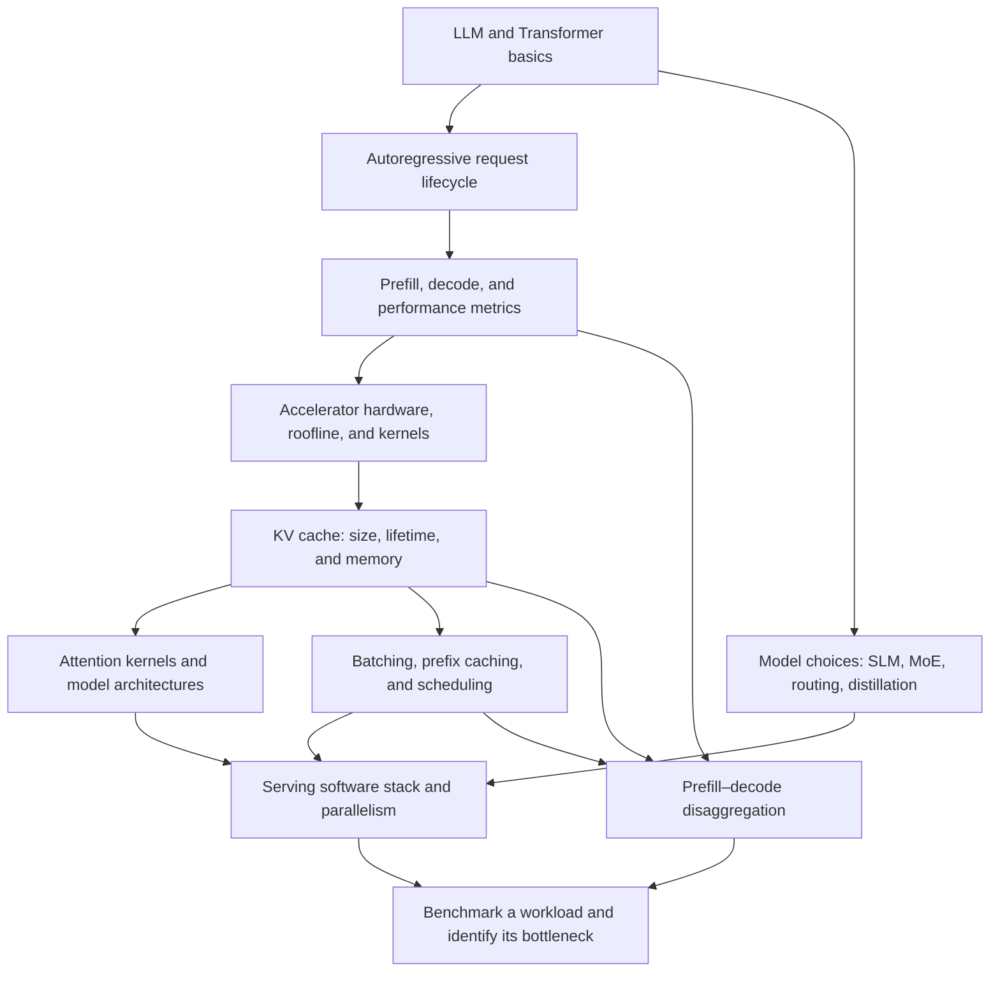

# Inference Engineering Learning Map

[Back to Inference Engineering](README.md) · [Back to the repository index](../README.md)

This map answers two questions: what should I learn first, and which topic should I follow when I identify a particular serving bottleneck? It covers all six parts and 28 topic entries currently listed in the source repository's README. Repeated explanations are combined into canonical notes.

## The main path

### 0. Review the model concepts

If tokens, causal attention, or the Transformer are unfamiliar, start with the [Generative AI index](../06-generative-ai/README.md), then read the introductory references in [Generation lifecycle and performance metrics](generation-lifecycle-and-metrics.md). Inference engineering assumes a trained model and focuses on executing it; it does not replace learning how the model was trained.

### 1. Understand one request end to end

Read [Generation lifecycle and performance metrics](generation-lifecycle-and-metrics.md). Be able to trace prompt tokens through prefill, the first generated token, and subsequent decode steps. Learn TTFT, inter-token latency/TPOT, end-to-end latency, and throughput before comparing optimizations.

### 2. Learn the hardware execution model

Read [Hardware and GPU kernels](hardware-and-kernels.md) before diving into kernel-level optimizations. Learn what moves between host memory, accelerator memory, and on-chip storage; how a CUDA kernel maps work to threads and blocks; and why GPU, TPU, and LPU designs make different trade-offs. Then use the [compute-versus-memory model](generation-lifecycle-and-metrics.md#a-simple-compute-versus-memory-model) to estimate which resource is likely to limit a phase.

### 3. Follow the memory path

Read [KV cache and memory management](kv-cache-and-memory.md), then [Attention kernels and model architectures](attention-kernels-and-model-architectures.md). First estimate how KV state scales with context and concurrent requests; then distinguish:

- **Allocation efficiency:** block allocation, block tables, and prefix sharing with PagedAttention.
- **Representation size:** lower-precision KV values, token eviction, or low-rank/latent approximations.
- **Attention execution:** FlashAttention's tiling and online softmax reduce intermediate memory traffic.
- **Model architecture:** fewer KV heads through MQA/GQA.

These approaches address related pressure but are not interchangeable. The notes include worked examples and explain what each technique does not solve.

### 4. Learn to keep the device busy

Read [Scheduling, caching, and speculative decoding](scheduling-caching-and-speculation.md). Static batching, continuous batching, chunked prefill, prefix caching, and speculative decoding affect different parts of the request path. Keep user-perceived latency separate from aggregate throughput when evaluating them.

### 5. Study model choices and system boundaries

Read [Architecture choices, routing, and distillation](architecture-routing-and-distillation.md) to distinguish choosing a small model, routing a request, using a sparse MoE layer, and training a student model. Then read [Prefill–decode disaggregation](prefill-decode-disaggregation.md): separating phases requires moving KV state, so its size and transfer path are central. Finish with [Serving engines and model formats](serving-engines-and-model-formats.md) to understand the device-to-engine-to-orchestration stack, quantization, distributed execution, file formats, and hardware-specific support.

## Choose a path by the symptom

| What you observe | Start with | Questions to ask |
| --- | --- | --- |
| The first token arrives late | [Generation lifecycle and performance metrics](generation-lifecycle-and-metrics.md), then [Scheduling, caching, and speculative decoding](scheduling-caching-and-speculation.md) | Is time spent in queueing, tokenization, a long prefill, or waiting behind decode work? Is the prefix reusable? |
| The answer starts promptly but streams slowly | [Generation lifecycle and performance metrics](generation-lifecycle-and-metrics.md), then [Scheduling, caching, and speculative decoding](scheduling-caching-and-speculation.md) | Is decode limited by weight/KV memory traffic, scheduling interference, or low draft acceptance? |
| GPU memory limits concurrency or context length | [KV cache and memory management](kv-cache-and-memory.md), then [Attention kernels and model architectures](attention-kernels-and-model-architectures.md) | How much memory is weights versus KV state? Is the issue fragmentation, duplicated prefixes, or the number of bytes per KV element/head? |
| Long prompts interrupt active generations | [Scheduling, caching, and speculative decoding](scheduling-caching-and-speculation.md), then [Prefill–decode disaggregation](prefill-decode-disaggregation.md) | Would chunked prefill be enough, or does sustained load justify separate worker pools and KV transfer? |
| Cost or latency varies widely by request difficulty | [Architecture choices, routing, and distillation](architecture-routing-and-distillation.md) | Can a smaller model handle common queries? Is routing overhead and escalation quality measured? |
| A kernel or accelerator choice is unclear | [Hardware and GPU kernels](hardware-and-kernels.md), then [Attention kernels and model architectures](attention-kernels-and-model-architectures.md) | Is the bottleneck compute, memory movement, launch overhead, shape support, or communication? |
| You need to choose a serving stack | [Serving engines and model formats](serving-engines-and-model-formats.md) | What hardware, model architecture, API, quantization, parallelism, and operational constraints must be supported? |

## Coverage of the source series

The table maps every topic entry listed in the GitHub README to the local canonical note. Related articles share a note when they explain the same mechanism; the original article links remain in each note's references.

| Source part | Repository topics | Local coverage |
| --- | --- | --- |
| 1 · The Basics | Autoregressive models; prefill vs decode; prefill–decode disaggregation | [Lifecycle and metrics](generation-lifecycle-and-metrics.md) · [Disaggregation](prefill-decode-disaggregation.md) |
| 2 · Memory and Attention Optimizations | KV cache; KV-cache compression; PagedAttention; FlashAttention; grouped-query attention | [KV cache and memory](kv-cache-and-memory.md) · [Attention kernels and architectures](attention-kernels-and-model-architectures.md) |
| 3 · Throughput and Latency | Continuous batching; speculative decoding; Medusa; EAGLE; n-gram speculation; token streaming; prompt caching | [Scheduling, caching, and speculation](scheduling-caching-and-speculation.md) · [Lifecycle and metrics](generation-lifecycle-and-metrics.md) |
| 4 · Engines and Formats | vLLM; SGLang; TensorRT-LLM; GGUF; Ollama | [Serving engines and model formats](serving-engines-and-model-formats.md) |
| 5 · Architecture-Level Optimizations | Mixture of Experts; small language models; LLM routing; knowledge distillation | [Architecture choices, routing, and distillation](architecture-routing-and-distillation.md) |
| 6 · Hardware | GPUs; CUDA kernels; Google TPUs; LPUs | [Hardware and GPU kernels](hardware-and-kernels.md) |

The GitHub README says "More blogs and videos coming soon," so this coverage table describes the repository's topics as inspected on 2026-10-30; it is not a promise that future additions are already covered.

The notes also draw on Inference Engineering's [software chapter](https://inferenceengineering.tech/chapters/software/) and the JAX Scaling Book's [inference](https://jax-ml.github.io/scaling-book/inference/) and [roofline](https://jax-ml.github.io/scaling-book/roofline/) chapters. These add a serving-stack taxonomy, idealized performance models, and distributed-cache examples; their hardware-specific measurements are not universal recommendations.

## A practical way to apply the map

1. Define a representative workload: prompt-length and output-length distributions, concurrency, arrival bursts, model and precision, and latency/quality targets.
2. Warm up, then measure a baseline at the same workload and request mix: TTFT, inter-token latency and tail percentiles, end-to-end latency, input/output token throughput, memory use, and queue depth. Include realistic arrival jitter, not only a uniform saturated batch; see [benchmarking guidance](generation-lifecycle-and-metrics.md#benchmarking-as-a-controlled-experiment).
3. Identify the limiting resource before changing the system. A low GPU utilization number alone does not identify whether the cause is memory traffic, insufficient batching, CPU/tokenizer work, communication, or idle scheduling.
4. Change one lever at a time and check both the intended metric and regressions in quality, tail latency, memory, and cost. For model routing or compression, include task quality in the acceptance criteria.
5. Repeat with realistic traffic. A technique that helps one prompt or a saturated synthetic batch may hurt a different request mix.

## Notes on terminology

Serving tools use slightly different metric definitions and names. In particular, TPOT may mean an average over output-token intervals, while inter-token latency describes the interval distribution; compare benchmark methodology as well as the metric label. See [Generation lifecycle and performance metrics](generation-lifecycle-and-metrics.md).
