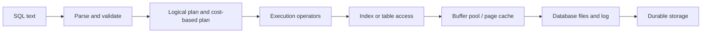

# Database internals: storage, indexes, logging, and execution

[Database design hub](README.md) · [Relational database design](relational-database-design.md) · [PostgreSQL administration](postgresql-administration.md) · [Query performance labs](query-performance-labs.md)

This note builds a mental model of what happens below SQL. It is intentionally engine-neutral where possible: real products make different choices, and even one product can change behavior by version, storage engine, configuration, and workload.

## The path from a query to storage

A database converts a declarative query into an execution plan, runs operators such as scans, joins, sorts, and aggregates, and asks the storage layer for pages. The plan is an estimate-driven choice, not a guarantee that a named index will be used. The data model and index determine which access paths are available; statistics and cost assumptions influence which one is selected.

## Pages, records, and buffer pools

Disk-oriented engines group records into fixed-size **pages** (sometimes called blocks). A table can be organized as a heap or another structure; an index is a separate maintained structure mapping keys to row locations or records. Page size, tuple layout, visibility metadata, and free-space handling vary among engines.

An engine cannot keep every database page in RAM when the database is larger than memory. A **buffer pool** manages a bounded set of in-memory **frames** that may hold pages:

1. A page request checks whether that page is already cached.
2. A cache hit reuses the resident frame; a miss reads the page from storage.
3. A page in use may be pinned or otherwise protected from eviction.
4. A modified page is marked dirty; it can be written later under recovery rules.
5. When memory is needed, an eviction policy chooses a replaceable page. LRU-like and clock-sweep approaches are examples, not a single universal policy.

The database buffer pool and operating-system page cache can both participate in caching. In PostgreSQL, `shared_buffers` controls the server's shared buffer area; the operating system also caches file data. Increasing a database cache does not make the OS cache irrelevant, and memory is shared with connections, query operators, maintenance, and the operating system. See [PostgreSQL memory configuration](https://www.postgresql.org/docs/current/runtime-config-resource.html).

Important vocabulary:

- A **page** is the logical unit of database I/O; a **frame** is a place in memory that can contain a page.
- A **clean** page matches the durable data-file state; a **dirty** page has modifications not yet written there.
- **Pinning** prevents a page from being evicted while an operator is using it; it does not mean the page is permanently resident.
- A **checkpoint** coordinates flushing/recovery progress; it is not necessarily a full synchronous write of every page for every transaction.
- A **cache hit** avoids a storage read, but its source may be a database cache or the operating system cache depending on the engine and measurement.

## B-tree-family indexes

A B-tree-family index maintains keys in sorted order across a balanced hierarchy of pages: a search follows internal pages to a leaf, then examines matching entries. Exact lookups and ordered/range scans are natural use cases. A page split may be needed when inserts fill a page; splits, page churn, and maintaining each index add write and storage costs.

Consequences for design:

- A composite ordered index can support prefixes and ranges according to that engine's rules; column order matters. Match it to predicates and requested ordering, then verify the plan.
- A range scan can read a contiguous part of an ordered index. An unordered or low-selectivity predicate may still be cheaper as a sequential scan.
- Secondary-index entries generally need a way to locate the table row, except when the engine can satisfy the query from the index. Visibility and storage rules can prevent an apparent covering index from becoming an index-only plan.
- Indexing every column is not free: it consumes storage, increases write work, and can affect vacuum/maintenance.

PostgreSQL documents B-tree alongside other access methods such as Hash, GiST, SP-GiST, GIN, and BRIN. A B-tree is a strong general-purpose starting point, not the right index for every operator or data shape.

## LSM trees and write-optimized storage

An **LSM-tree** (Log-Structured Merge tree) converts many small random updates into sequential writes and later merges sorted structures. A simplified write path is:

1. Append a recovery record to a write-ahead log when durability requires it.
2. Apply the key/value change to an in-memory sorted structure (often called a memtable).
3. Flush a full immutable memtable as a sorted on-disk table (SSTable).
4. Merge/compact SSTables in the background into levels or runs.

Reads may need to consult the memory table and several on-disk components. Bloom filters can rule out many files that do not contain a key, while compaction bounds the number and layout of structures. Deletes are often represented by tombstones until compaction can safely remove obsolete data.

| Trade-off | B-tree-family layout | LSM-family layout |
| --- | --- | --- |
| Typical strength | Point/range reads with ordered pages and predictable access paths. | High write throughput by buffering and writing sorted batches sequentially. |
| Write cost | Updates may modify table and multiple indexes with page-level work. | Writes are buffered, but later compaction rewrites data. |
| Read cost | Often one tree traversal plus table access; depends on selectivity/cache. | May check several levels/files; filters and compaction reduce this. |
| Space/maintenance | Page splits, free space, and index maintenance matter. | Compaction can temporarily retain multiple versions and needs I/O/space. |
| Main tuning risk | Poor index choice or excessive index maintenance. | Read/write/space amplification and compaction interference. |

The table is a conceptual comparison, not a claim that every engine has only one structure. “Read amplification” means extra read work relative to requested logical data; “write amplification” means internal bytes written relative to application bytes; “space amplification” means physical retained data relative to logical live data. These are workload- and implementation-dependent measures. RocksDB is a configurable embedded key-value engine whose overview documents its goals, architecture, trade-offs, and production support.

## Write-ahead logging, durability, and recovery

**Write-ahead logging (WAL)** follows the rule that recovery information describing a change must become durable before the corresponding modified data page is allowed to be written as durable. A transaction can therefore commit after the relevant log records are safely flushed without forcing every modified table/index page to storage at that moment.

After a crash, the engine uses logs and checkpoints to recover a consistent state. In redo-style recovery, it reapplies logged changes that were committed but not yet reflected in data files. Specific engines may also need undo, version cleanup, or other recovery work. A checkpoint limits how much log must be replayed; it does not eliminate the need for the log.

WAL also connects several operations that are easy to confuse:

- **Crash recovery:** replay local log records after an unclean shutdown.
- **Archiving:** retain log segments together with a base backup so the database can be restored to a selected time (PITR).
- **Physical replication:** send or replay storage-level log changes on a standby.
- **Logical replication:** publish row/table changes through a logical representation; it has different filtering and compatibility properties.
- **Backup:** create a recoverable historical copy. A live replica alone is not a backup because it can reproduce accidental changes or corruption.

Durability still depends on storage and configuration honoring flush/sync requests. A system design must set the intended RPO/RTO, archive and retain the needed logs, and regularly test recovery. PostgreSQL explains its WAL rule and [continuous archiving/PITR](https://www.postgresql.org/docs/current/continuous-archiving.html); SQLite's [WAL mode](https://www.sqlite.org/wal.html) illustrates that WAL has engine-specific concurrency and filesystem constraints.

## MVCC, locks, and vacuum

Many relational engines use **multi-version concurrency control (MVCC)** so readers can observe a consistent snapshot while writers create newer row versions. A transaction's snapshot and isolation level determine which committed changes it can observe; MVCC does not mean “no locks” or that every race is prevented.

- **Locks** coordinate conflicting logical operations and protect correctness at transaction scope.
- **Latches** are short-lived synchronization primitives protecting in-memory structures inside an engine. They are not interchangeable with SQL locks.
- **Deadlocks** can occur when transactions wait on each other's locks; engines detect some and abort a participant. Applications should handle safe retries.
- **Vacuum/garbage collection** reclaims or marks obsolete versions once no active snapshot can need them, and maintains visibility/statistics according to engine rules.

Long-running transactions can retain old snapshots and delay cleanup. In PostgreSQL this can contribute to table bloat and, if allowed to continue unchecked, transaction-ID wraparound risk. Monitor the engine's own maintenance state rather than treating `VACUUM` as a one-off cure.

## Query processing and the optimizer

A simplified query-engine pipeline is:

1. Parse SQL and resolve names, types, and permissions.
2. Rewrite or normalize the query.
3. Enumerate legal plans and estimate their cost using table/index statistics.
4. Select a plan, then execute operators that request rows/pages from storage.
5. Return results through the client protocol.

Operators include sequential/index scans, nested-loop/hash/merge joins, sorts, and aggregates. A nested loop is not inherently bad; it can be excellent when the outer input is small and the inner lookup is indexed. A sequential scan is not inherently bad either; it can beat index lookups when a large fraction of a table is needed.

The most useful diagnostic is often a large divergence between estimated and actual rows, because a bad cardinality estimate can make later join and memory choices poor. Statistics, data skew, correlated columns, stale analysis, and parameter-sensitive workloads can affect estimates. See [Query performance labs](query-performance-labs.md) for a disciplined plan-reading method.

## Trace two operations end to end

### Reading a row by key

1. The planner selects an index or scan path based on query predicates, statistics, and costs.
2. The executor requests index/table pages.
3. The buffer pool serves cache hits or reads missing pages.
4. Visibility rules determine which row version the transaction may return.
5. The executor projects and returns the result.

### Committing a change

1. The transaction checks constraints and concurrency rules.
2. The engine creates the relevant log records and modified in-memory pages/versions.
3. The commit is acknowledged when the configured durability condition is met.
4. Dirty table/index pages can be written later, subject to WAL/recovery ordering.
5. Checkpointing, vacuum/cleanup, replication, and archiving make progress independently.

These are simplified flows. Use the actual engine's documentation before making a durability or failover guarantee.

## How to study internals without getting lost

1. Begin with relational concepts, SQL, transactions, and indexes in [Relational database design](relational-database-design.md).
2. Observe real plans and buffers using the [query-performance labs](query-performance-labs.md).
3. Follow one engine's operational path in [PostgreSQL administration](postgresql-administration.md): WAL, vacuum, monitoring, backup, and replication.
4. Study B-tree and LSM alternatives; identify which read/write workload each is intended to serve.
5. For implementation depth, use the CMU database systems course and its BusTub projects. Expect systems programming and substantial projects, not a short SQL tutorial.

## Sources and further study

Inspected on **2026-11-06**. The descriptions here are synthesized; book and course material is not reproduced.

- [CMU 15-445/645 Database Systems course](https://csd.cmu.edu/course/15445/s25) — course scope includes storage models, heaps, indexes, transaction processing, concurrency, recovery, query processing, parallel/distributed architectures, and system implementation. Strong systems-programming background is expected.
- [CMU BusTub Fall 2026 Project 1](https://15445.courses.cs.cmu.edu/fall2026/project1/) — a term-specific buffer-pool project page explaining pages, frames, disk I/O abstraction, and thread safety. Check the active term's instructions and restrictions before attempting course assignments.
- [RocksDB Overview](https://github.com/meta/rocksdb/wiki/RocksDB-Overview) — describes RocksDB as a configurable embedded key-value storage engine and links to its architecture and operational details. Its choices are not a specification for every LSM implementation.
- [PostgreSQL WAL introduction](https://www.postgresql.org/docs/current/wal-intro.html), [resource configuration](https://www.postgresql.org/docs/current/runtime-config-resource.html), [MVCC/concurrency control](https://www.postgresql.org/docs/current/mvcc.html), and [routine vacuuming](https://www.postgresql.org/docs/current/routine-vacuuming.html) — engine-specific behavior and maintenance.
- [SQLite architecture](https://www.sqlite.org/arch.html) — SQL compilation to bytecode and execution by a virtual machine; useful as a contrast to a client/server server process.
- [SQLite WAL](https://www.sqlite.org/wal.html) — WAL advantages and limitations, including same-host constraints for participating processes.
- [Database System Concepts, 7th edition](https://www.db-book.com/) — book resources for relational theory, query processing, transactions, and recovery.
- [Database Internals by Alex Petrov](https://www.oreilly.com/library/view/database-internals/9781492040330/) — optional book-length treatment of storage engines and distributed data systems. The publisher page returned HTTP 403 to the research fetcher, so its contents were not independently inspected here; consult the publisher/catalog page for edition and availability.

## Related notes

- [Database engine comparison](database-engine-comparison.md) — compare these ideas across PostgreSQL, InnoDB, SQL Server, and SQLite.
- [Data warehousing and OLAP](data-warehousing-and-olap.md) — analytical storage and columnar execution.
- [Messaging and event streaming](../messaging-and-event-streaming.md) — logs, delivery, and event-processing concepts that connect to data platforms.
