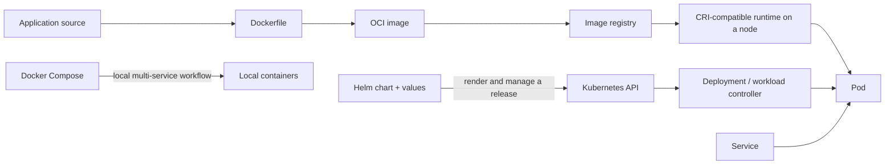

# Docker, Kubernetes, and Helm: A Problem-First Guide

[Back to Cloud and DevOps](../README.md) · [Repository home](../../README.md)

This package teaches the problems behind containers and orchestration, how the tools fit together, when each is useful, how to build a deployment, and how to diagnose common failures. It is organized to help you reason from a requirement to a suitable tool, not memorize commands or YAML in isolation.

## What problem does each tool solve?

| Need or problem | Use | Why it fits | It does not do |
| --- | --- | --- | --- |
| Package an app and its user-space runtime dependencies consistently | **Docker image** | Build a versioned image once and run it using a compatible container runtime | Bundle a whole guest kernel or guarantee that the app is correct or secure |
| Run a few cooperating services locally, with networks and volumes | **Docker Compose** | Describe and operate a multi-container application with one Compose file | Provide Kubernetes-style scheduling and reconciliation across a cluster |
| Keep workloads running across machines, replace failed Pods, expose stable service addresses, and roll out versions declaratively | **Kubernetes** | A control plane schedules Pods and controllers continually reconcile actual state toward declared state | Remove the need to design a healthy app, choose good probes, monitor it, or operate the cluster |
| Package reusable Kubernetes resources and parameterize repeatable deployments | **Helm** | A chart combines manifests, templates, default values, dependencies, and release history | Build images, run containers, or continuously reconcile a workload at runtime |

These are complementary, not three competing container tools:

Docker is commonly used to build images; Kubernetes can run images through a CRI-compatible runtime such as containerd or CRI-O. Kubernetes does not require Docker Engine on each node. Helm packages and manages Kubernetes resources, while Kubernetes controllers manage workload state.

## Start with the guide that fits your question

1. [Docker](docker.md): “How do I build, run, configure, network, and persist data for an application container?”
2. [Kubernetes](kubernetes.md): “How do I run replicas across a cluster, expose them, update them, and recover from failures?”
3. [Helm](helm.md): “How do I reuse and version Kubernetes manifests across releases or environments?”
4. [Learning path and capstone lab](learning-path.md): “How do I practice the complete workflow and verify that I understand it?”

### A few examples

- **A script or small service on one host:** Start with a process, package manager, or container. Kubernetes may add unnecessary operational cost.
- **A local API and database:** Use Docker Compose to define services, local networking, and persistent development data.
- **A web service that must be rescheduled or scaled across several worker machines:** Kubernetes may fit if the team can operate a cluster or use a managed Kubernetes service.
- **Several Kubernetes environments with shared structure but different configuration:** Consider Helm when templated, versioned releases reduce duplication. Plain manifests are often clearer for a very small deployment.
- **An application with a database:** Kubernetes can run a stateful workload, but it does not automatically make the database highly available or provide backups. Consider a managed database or design storage, failover, backup, and restore explicitly.

Do not introduce Kubernetes solely because an application has containers or microservices. A managed application platform, a VM, or a single-host Compose deployment can be the better engineering choice.

## Suggested prerequisites

You do not need to be a cluster administrator before starting. Be comfortable with:

- Processes, environment variables, filesystems, exit codes, ports, and logs.
- Basic HTTP, TCP/IP, DNS, and the difference between `localhost` on a host and inside a container.
- Command-line usage, Git, YAML indentation, and reading structured configuration.
- Basic reliability and security ideas such as health, least privilege, secret handling, and backups.

Review the [Foundations](../../01-foundations/README.md) and [System Design](../../04-system-design/README.md) indexes if those concepts are unfamiliar.

## The learning sequence

Learn the whole path using one small stateless HTTP service:

1. Run it locally and document its port, configuration, and health endpoints.
2. Build an image and run it with Docker; inspect its logs, environment, port mapping, and filesystem.
3. Add a dependency such as a database locally using Compose; learn service-name DNS and persistent volumes.
4. Load the same image into a local Kubernetes cluster; create a Deployment and Service.
5. Add readiness/startup/liveness probes, resource requests, configuration, and a controlled rollout.
6. Package the Kubernetes resources with Helm only after the raw manifests make sense.
7. Test a failed rollout, inspect the cause, and recover. Treat data migrations and persistent data separately from a resource rollback.

The [capstone lab](learning-path.md) gives checkpoints, commands, failure scenarios, and cleanup instructions.

## Detailed guides

- [Docker: images, containers, Compose, and image quality](docker.md)
- [Kubernetes: architecture, workloads, networking, operations, and debugging](kubernetes.md)
- [Helm: charts, values, releases, and safe upgrades](helm.md)
- [Learning path: an eight-week plan and one end-to-end capstone](learning-path.md)

## Source review and further reading

Primary references were reviewed on 2026-10-30. These guides summarize the official documentation in original language; links below lead to the relevant concepts and follow-on topics.

### Docker

- [Get started](https://docs.docker.com/get-started/)
- [Dockerfile reference](https://docs.docker.com/reference/dockerfile/)
- [Build best practices](https://docs.docker.com/build/building/best-practices/)
- [Multi-stage builds](https://docs.docker.com/build/building/multi-stage/)
- [Build secrets](https://docs.docker.com/build/building/secrets/)
- [Networking overview](https://docs.docker.com/engine/network/)
- [Volumes](https://docs.docker.com/engine/storage/volumes/)
- [Docker Compose](https://docs.docker.com/compose/) and [using Compose in production](https://docs.docker.com/compose/how-tos/production/)
- [Docker Desktop for Mac](https://docs.docker.com/desktop/setup/install/mac-install/)

### Kubernetes

- [Learn Kubernetes Basics](https://kubernetes.io/docs/tutorials/kubernetes-basics/)
- [Cluster architecture](https://kubernetes.io/docs/concepts/architecture/)
- [Pods](https://kubernetes.io/docs/concepts/workloads/pods/) and [container runtimes](https://kubernetes.io/docs/setup/production-environment/container-runtimes/)
- [Deployments](https://kubernetes.io/docs/concepts/workloads/controllers/deployment/)
- [Services](https://kubernetes.io/docs/concepts/services-networking/service/) and [cluster networking](https://kubernetes.io/docs/concepts/cluster-administration/networking/)
- [Probes](https://kubernetes.io/docs/concepts/workloads/pods/probes/)
- [Resource management](https://kubernetes.io/docs/concepts/configuration/manage-resources-containers/)
- [ConfigMaps](https://kubernetes.io/docs/concepts/configuration/configmap/) and [Secrets](https://kubernetes.io/docs/concepts/configuration/secret/)
- [Persistent Volumes](https://kubernetes.io/docs/concepts/storage/persistent-volumes/)
- [Horizontal Pod Autoscaling](https://kubernetes.io/docs/concepts/workloads/autoscaling/horizontal-pod-autoscale/)
- [Ingress](https://kubernetes.io/docs/concepts/services-networking/ingress/) and [Gateway API](https://kubernetes.io/docs/concepts/services-networking/gateway/)
- [Troubleshooting applications](https://kubernetes.io/docs/tasks/debug/debug-application/)
- [kind quick start](https://kind.sigs.k8s.io/docs/user/quick-start/) and [Minikube start](https://minikube.sigs.k8s.io/docs/start/)
- [kubectl installation for macOS](https://kubernetes.io/docs/tasks/tools/install-kubectl-macos/)

### Helm

- [Helm Quickstart](https://helm.sh/docs/intro/quickstart/)
- [Using Helm](https://helm.sh/docs/intro/using_helm/)
- [Charts and chart structure](https://helm.sh/docs/topics/charts/)
- [Values files](https://helm.sh/docs/chart_template_guide/values_files/) and [values best practices](https://helm.sh/docs/chart_best_practices/values/)
- [Helm 4 overview](https://helm.sh/docs/overview/)
- [Helm/Kubernetes version support](https://helm.sh/docs/topics/version_skew/)
- [OCI registries](https://helm.sh/docs/topics/registries/) and [Artifact Hub](https://artifacthub.io/)

At research time, the official docs describe Helm 4 and state that Helm v2-format charts continue to work; chart v3 is experimental. The chart-structure, values, and OCI reference pages carry a notice that they have not yet been fully updated for Helm 4. Examples here use the established `apiVersion: v2` chart format and avoid Helm 4-specific features. Check the current version-skew and migration guidance for a real cluster; do not assume every older Helm 3 tutorial describes Helm 4 behavior.

The earlier root note also contained indirect image-proxy URLs and older third-party links. Those were not treated as authoritative references; the package uses direct project documentation instead. [Kubernetes The Hard Way](https://github.com/kelseyhightower/kubernetes-the-hard-way) remains an optional advanced internals exercise, not a production cluster recipe; its repository currently documents Kubernetes v1.32.x and warns that the result is not production ready.
