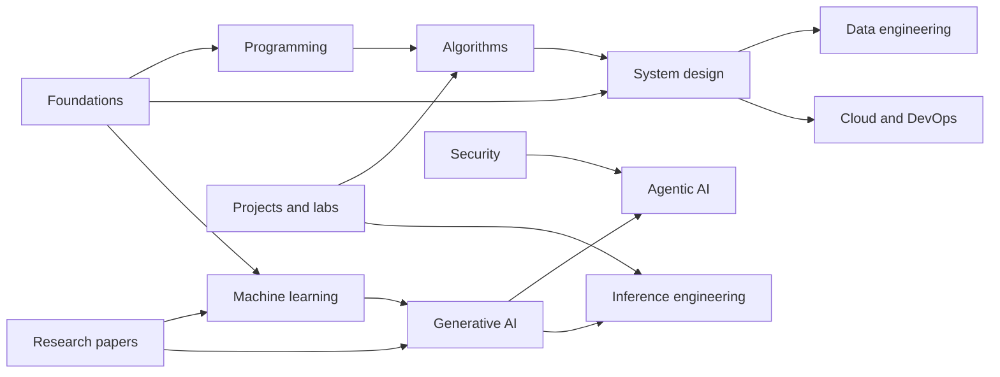

# Engineering Notes

A connected, growing knowledge base for computer science and software engineering: from programming fundamentals and algorithms to system design, machine learning, AI, infrastructure, and research.

The goal is not to collect disconnected Markdown files. Notes should explain ideas clearly, connect prerequisites and applications, preserve useful learning insights, and point to reliable sources.

> **Work in progress:** This repository is actively being built. Its structure and content will keep evolving as notes are added, refined, and connected.

## Browse by domain

| Domain | Focus |
| --- | --- |
| [01 · Foundations](01-foundations/README.md) | Computer systems, networking, databases, concurrency, and distributed systems |
| [02 · Programming](02-programming/README.md) | Languages, runtimes, testing, debugging, and software practices |
| [03 · Data structures and algorithms](03-data-structures-algorithms/README.md) | Core data structures, algorithmic techniques, and problem solving |
| [04 · System design](04-system-design/README.md) | Architecture, APIs, data, reliability, and design trade-offs |
| [05 · Machine learning](05-machine-learning/README.md) | ML foundations, deep learning, evaluation, and deployment |
| [06 · Generative AI](06-generative-ai/README.md) | Transformers, language models, retrieval, and generative applications |
| [07 · Agentic AI](07-agentic-ai/README.md) | Agents, tools, workflows, orchestration, and evaluation |
| [08 · Inference engineering](08-inference-engineering/README.md) | Efficient model serving, performance, and inference systems |
| [09 · Data engineering](09-data-engineering/README.md) | Data systems, pipelines, storage, quality, and governance |
| [10 · Cloud and DevOps](10-cloud-devops/README.md) | Cloud infrastructure, delivery, operations, and reliability |
| [11 · Security](11-security/README.md) | Secure engineering, application security, and threat modeling |
| [12 · Research papers](12-research-papers/README.md) | Paper summaries, methods, results, and reproduction notes |
| [13 · Projects and labs](13-projects-labs/README.md) | Runnable experiments, implementation studies, and benchmarks |
| [14 · Interview preparation](14-interview-prep/README.md) | Practice and revision across engineering interview topics |
| [15 · Reading notes](15-reading-notes/README.md) | Notes from books, articles, courses, and documentation |

## Suggested learning paths

These are starting points; follow links between domains as your questions require.

- **Software engineering:** [Foundations](01-foundations/README.md) → [Programming](02-programming/README.md) → [Data structures and algorithms](03-data-structures-algorithms/README.md) → [System design](04-system-design/README.md) → [Cloud and DevOps](10-cloud-devops/README.md) and [Security](11-security/README.md).
- **Algorithms:** [Programming](02-programming/README.md) → [Data structures and algorithms](03-data-structures-algorithms/README.md) → [Interview preparation](14-interview-prep/README.md).
- **System design:** [Foundations](01-foundations/README.md) → [System design](04-system-design/README.md) → [Data engineering](09-data-engineering/README.md), [Cloud and DevOps](10-cloud-devops/README.md), and [Security](11-security/README.md).
- **Container deployment:** [Docker, Kubernetes, and Helm learning package](10-cloud-devops/containers-orchestration/README.md) → [hands-on learning path](10-cloud-devops/containers-orchestration/learning-path.md) → [system design](04-system-design/README.md) and [security](11-security/README.md).
- **ML and generative AI:** [Foundations](01-foundations/README.md) → [Machine learning](05-machine-learning/README.md) → [Generative AI](06-generative-ai/README.md) → [Agentic AI](07-agentic-ai/README.md).
- **Agentic AI:** [Generative AI](06-generative-ai/README.md) → [Agentic AI](07-agentic-ai/README.md) → [System design](04-system-design/README.md) and [Security](11-security/README.md).
- **Inference engineering:** [Foundations](01-foundations/README.md) → [Machine learning](05-machine-learning/README.md) → [Generative AI](06-generative-ai/README.md) → [Inference engineering learning map](08-inference-engineering/MAP.md) and [topic index](08-inference-engineering/README.md).

## Discover and connect concepts

Start with the domain indexes above, then follow prerequisites, related topics, implementations, experiments, and sources from each note. The [shared glossary](shared/glossary/README.md) is the planned home for concise definitions; canonical explanations will live in their domain.

The domains are connected rather than isolated:

## Shared resources

- [Templates](shared/templates/README.md) — reusable note outlines.
- [Diagrams](shared/diagrams/README.md) — diagrams shared across notes.
- [Snippets](shared/snippets/README.md) — small reusable code and command examples.
- [Glossary](shared/glossary/README.md) — concise terms linked to canonical notes.
- [Research papers](12-research-papers/README.md), [projects and labs](13-projects-labs/README.md), and [reading notes](15-reading-notes/README.md).

## Navigating and contributing

Use the domain README to find the right area. Search the repository for existing concepts before creating a new canonical note. Write original explanations, cite reliable sources, distinguish source claims from personal interpretation, and include tested examples when appropriate. Keep notes focused, link to prerequisites and related concepts using relative Markdown links, and update affected indexes when content changes.

This knowledge base is being built incrementally. Some domains already contain substantive notes and learning packages, while others are still indexes describing their scope and intended organization. Follow each domain index to see what is available. The [engineering knowledge maintainer skill](.github/skills/engineering-knowledge-maintainer/SKILL.md) describes how Copilot should help keep the knowledge base coherent.
